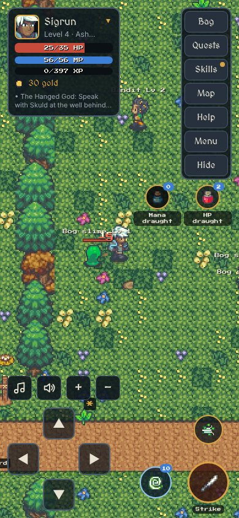
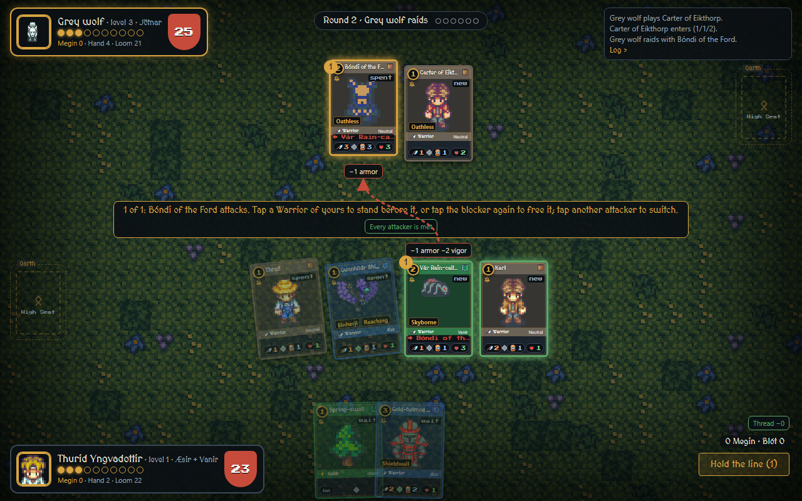

# Nornloom

**Play in the browser: [nornloom.com](https://nornloom.com).** Two games, one world. Neither has
adverts, and playing alone needs no account.

You play a skald-in-training from the village of Eikthorp, pulled into the roots of Yggdrasil by
the Norn Skuld. The threads of fate are fraying because the old stories are being forgotten. You
walk into those stories, live through them beside the gods, and carry them back so the weave holds.
Every main quest is a real myth from the Eddas, and the myths keep their real endings. Thor loses to
Elli. Týr loses his hand. Baldr dies and cannot be saved. You shape how events unfold, never how
they end.

The two games tell that story in two ways, the action game first:

| | **Nornloom: Wolf Age**, the action game | **Nornloom**, the card adventure |
| --- | --- | --- |
| How you fight | In real time, right on the map: strike, use your class's arts and spells, roll out of the blows | Every fight is a hand of **Bindrune**, a card game, played with the deck you build from six peoples |
| Your hero grows by | Gear, levels and a skill tree for one of four classes | Cards, gear and levels |
| Play it | [fight.nornloom.com](https://fight.nornloom.com) | [nornloom.com/play](https://nornloom.com/play) |
| **How to play, in pictures** | [Your first steps](wolf-age/TUTORIAL.md) | [Your first duel](TUTORIAL.md) |
| **Quest guide** | [The Skald's Road](wolf-age/QUESTS.md) (also on the game's site: [fight.nornloom.com/guide](https://fight.nornloom.com/guide)) | [The Skald's Road](QUESTS.md) |
| Questions players ask | [FAQ](wolf-age/FAQ.md) | [FAQ](FAQ.md) |
| The rules in full | [The Wolf Age handbook](wolf-age/HANDBOOK.md) | [The Bindrune handbook](BINDRUNE.md) |
| What changed | [Release notes](wolf-age/RELEASE_NOTES.md) | [Release notes](RELEASE_NOTES.md) |

[nornloom.com](https://nornloom.com) opens on a page where you pick one. The heroes of the two games
are separate: a hero made in one does not walk into the other.

## Nornloom: Wolf Age, the action game

The same world and the same myths, fought in real time. There is no fight screen: beasts roam the
map, notice you and come for you, and you fight where you stand. Choose a class (Berserker,
Shieldmaiden, Huntress or Seidr-worker), grow its skill tree, wear the gear you find and forge, and
climb from level 1 to 99. Played alone, or signed in with other players in the shared worlds, where
you can hunt together, trade at the market and take a party into the raid halls.

| You want | Go to |
| --- | --- |
| To learn to play, one button at a time | [wolf-age/TUTORIAL.md](wolf-age/TUTORIAL.md), your first steps in pictures: making a hero, the screen, the first quest, a fight, the bag, the skills, the map, the waystones and a fall, each with a phone screenshot, and every control in two tables. |
| Help with a quest: where to go, who to talk to, what to fight, the riddles' answers | [wolf-age/QUESTS.md](wolf-age/QUESTS.md), The Skald's Road for Wolf Age: every saga step by step with a screenshot of each, from [The Waking](wolf-age/QUESTS.md#the-waking) to [Ragnarök](wolf-age/QUESTS.md#ragnarök), the [side sagas](wolf-age/QUESTS.md#the-side-sagas), the [village work](wolf-age/QUESTS.md#village-work) and [the hamlets](wolf-age/QUESTS.md#the-hamlets). In the game, each quest in the quest log links its own page. |
| Questions players ask | [wolf-age/FAQ.md](wolf-age/FAQ.md), the same as the FAQ in the game's help book. |
| The rules in full | [wolf-age/HANDBOOK.md](wolf-age/HANDBOOK.md), the handbook: every class and its arts, every skill of every tree, the spells, the gods, the armour sets, every land and its beasts, the strongholds, the raid halls and what comes after the story, with the game's own numbers. |
| What changed, and which bugs are fixed | [wolf-age/RELEASE_NOTES.md](wolf-age/RELEASE_NOTES.md). |

## Nornloom, the card adventure

**Bindrune** is the card game inside Nornloom. Every fight in the wild is a hand of it, the
villagers play it too, and online the duels between heroes are hands of it. Two players build decks
from six peoples (Æsir, Vanir, Jötnar, Dvergar, Helheim and Muspell), spend Megin, and fight until
one side's Thread runs out. Warriors lose Armor for good as they fight, so winning still costs
something. Played alone, or online with others on the worlds.

| You want | Go to |
| --- | --- |
| To learn how a fight works, one button at a time | [TUTORIAL.md](TUTORIAL.md), your first duel in pictures: Hrafn's lesson step by step with a screenshot of every press, and the order of a turn (Blót, Play, Raid, End turn) in one table. Written so a young player can follow it. |
| Help with a quest: where to go, who to talk to, what to fight, the riddles' answers | [QUESTS.md](QUESTS.md), The Skald's Road: every saga step by step with a screenshot of each, from [The Waking](QUESTS.md#the-waking) to [Ragnarök](QUESTS.md#ragnarök), the [side sagas](QUESTS.md#the-side-sagas), the [village work](QUESTS.md#village-work) and [the hamlets](QUESTS.md#the-hamlets). |
| The rules of Bindrune, in full | [BINDRUNE.md](BINDRUNE.md), the handbook. Its chapters are listed [below](#the-bindrune-handbook-chapter-by-chapter). |
| A rule, a keyword, a card or a word | The handbook's [Keywords](BINDRUNE.md#keywords), [What a card's text can say](BINDRUNE.md#what-a-cards-text-can-say) and [Dictionary](BINDRUNE.md#dictionary). |
| A people, its gods and its saga cards | [The six peoples, and the road](BINDRUNE.md#the-six-peoples-and-the-road): [Æsir](BINDRUNE.md#æsir), [Vanir](BINDRUNE.md#vanir), [Jötnar](BINDRUNE.md#jötnar), [Dvergar](BINDRUNE.md#dvergar), [Helheim](BINDRUNE.md#helheim), [Muspell](BINDRUNE.md#muspell) and [Neutral](BINDRUNE.md#neutral). |
| Questions players ask | [FAQ.md](FAQ.md): [the story game](FAQ.md#the-story-game) and [playing online](FAQ.md#playing-online). |
| What changed, release by release, and which bugs are fixed | [RELEASE_NOTES.md](RELEASE_NOTES.md). |
| Screenshots | [How the game looks](BINDRUNE.md#how-the-game-looks) in the handbook, or the files in [images/](images). |

In the game, How to play and About are on the title screen, and Help opens the book: About, Getting
started, Bindrune, Step by step, FAQ, Privacy and Terms.

### The Bindrune handbook, chapter by chapter

Every number in [BINDRUNE.md](BINDRUNE.md) is read from the game's own rules when the page is
built, so when a rule changes the page changes with the next release.

- [How the game looks](BINDRUNE.md#how-the-game-looks): nine screenshots, from the title screen to
  a card open to read, each with a line on what is on it.
- [The numbers](BINDRUNE.md#the-numbers): Thread, the starting hand, the Well, Megin at Dawn and
  every limit, in one table.
- [The board](BINDRUNE.md#the-board): the Loom, the Well, the Shieldwall, the Garth, the High Seat, Valhalla,
  Helheim and the Void, and what each word means in plain terms.
- [A hand, turn by turn](BINDRUNE.md#a-hand-turn-by-turn): sitting down, the six phases, Megin, the
  Well and the Blót, chant windows and the stack.
- [The Raid](BINDRUNE.md#the-raid): who may raid, who may block, where the damage goes.
- [Glory, Rune-dust and the smiths](BINDRUNE.md#glory-rune-dust-and-the-smiths): the Boast, the
  Mend and the Ransom, and what Glory is worth after the hand.
- [The Doom Track](BINDRUNE.md#the-doom-track): why every hand ends, step by step from round 12.
- [The cards](BINDRUNE.md#the-cards): the face, the seven types, and how many there are and where
  they come from (1404 cards: 104 saga cards written by hand, each citing its source in the Eddas,
  and a host of 1300 forged by rule).
- [Keywords](BINDRUNE.md#keywords): all 24, with the Old Norse word behind each where there is one.
- [What a card's text can say](BINDRUNE.md#what-a-cards-text-can-say): the closed language of card
  text, its triggers, effects and auras.
- [The six peoples, and the road](BINDRUNE.md#the-six-peoples-and-the-road): pacts and feuds, then
  each people with its way of fighting, its gods and its saga cards.
- [Building a deck](BINDRUNE.md#building-a-deck): the deck rules, and what a smaller deck buys you.
- [The foes](BINDRUNE.md#the-foes): the archetypes every beast of the world drafts its thirty by,
  the traits the strong ones carry, and the named foes of the sagas.
- [Dictionary](BINDRUNE.md#dictionary): the words of the board and the table, A to Z.
- [Saying the names](BINDRUNE.md#saying-the-names): how to say Megin, Blót, Seiðr and the rest.

## What this repository is for

This is the public front door of both games: **the guides, bug reports, ideas and questions**. The
games' source and their licensed art live in private repositories, so there is no code here: this
page, the guides, the handbook, the FAQs, the credits, the screenshots and the issue forms.

- **Have a question?** Read the FAQ of your game first: [Wolf Age's](wolf-age/FAQ.md) or the
  [card adventure's](FAQ.md). A question about a Bindrune rule, card or word is probably answered
  in the [handbook](BINDRUNE.md).
- **Found a bug?** Open a [bug report](https://github.com/bc4all/Nornloom/issues/new?template=bug_report.yml).
- **Have an idea?** Open an [idea](https://github.com/bc4all/Nornloom/issues/new?template=idea.yml).
- **Something the FAQ does not answer, or that fits neither?** Open a [blank issue](https://github.com/bc4all/Nornloom/issues/new).

Both forms ask which game it is about. Before opening one, have a look through the
[open issues](https://github.com/bc4all/Nornloom/issues) in case it is already there; a thumbs-up on
an existing issue counts. Both games point here: the title screen and the About page have a button
for the issue forms.

### What makes a good bug report

- Which game: Wolf Age or Nornloom (the cards).
- What you did, step by step, and what you expected to happen.
- What happened instead. A screenshot helps a great deal.
- Where you were: the land, the quest, or the fight (the foe's name and level).
- Your hero's level, and your class (Wolf Age) or the peoples of your deck (Nornloom).
- The browser and device (for example "Chrome on Windows 11" or "Safari on an iPhone 13").

### What makes a good idea

- The problem it solves or the moment it improves, before the solution.
- If it is about a card, a quest or a myth: which one, and the source if you know it. Nornloom
  never invents a god, a realm or a named being, and every myth keeps its ending.

## Good to know

- Both games are early builds. A solo hero is saved on the device you play on; signed in, it is kept
  for your account too. The FAQs say what that means in practice.
- Saves may be reset between versions while the games are young. If that happens, it will be said
  on this page.
- The games have no ads and no tracking. Signing in sets one cookie. What is kept and why is on each
  game's privacy page: [nornloom.com/privacy](https://nornloom.com/privacy) and
  [fight.nornloom.com/privacy](https://fight.nornloom.com/privacy); the rules are on the terms pages
  beside them. They are the same pages as in the games' help books.
- Both games speak seven tongues: English, Polish, German, Spanish, Danish, Swedish and Norwegian.
  In the card adventure, card text, the villagers and the sagas still speak English.

## Credits

Art: Time Fantasy by finalbossblues (Jason Perry). Fonts: MedievalSharp (Wojciech Kalinowski),
Press Start 2P (CodeMan38), Noto Sans Runic (the Noto Project). Music and sounds: alkakrab and
Kenney. The stories follow the Poetic Edda (Bellows, 1923) and Snorri Sturluson's Prose Edda
(Brodeur, 1916). Every third-party asset of both games, with its author, source and licence, is
listed in [CREDITS.md](CREDITS.md).
