# Your first steps in Nornloom: Wolf Age

Nornloom: Wolf Age is the action game of Nornloom: the same world and the same myths as the card game, but every fight happens right on the map, in real time. This guide walks your first half hour with you, one button at a time, with a picture of every step. The pictures are from a phone held upright, because that is where most people play; on a computer the same buttons are there, and the keyboard works too.

Play it in the browser at [fight.nornloom.com](https://fight.nornloom.com). It is free, has no adverts and nothing to buy, and playing alone needs no account.

**The golden rule:** the plate in the top left corner always names the next thing to do. If you are lost, read it.

---

## The short version

- **Walk** with the arrow pad in the bottom left corner (on a computer: the arrow keys or WASD).
- **Talk** by walking into someone. A **!** over a head means a quest to offer; a bright **?** means they have something for you now.
- **Fight** with the round buttons in the bottom right corner: **Strike** is the big one, your **art** sits beside it, and the **dodge roll** above it.
- **Win** by bringing a beast's health to nothing before it does the same to you. Each beast pays gold and experience, and sometimes gear.
- **Grow** with the menu in the top right corner: **Bag** for your gear, **Quests** for the quest log, **Skills** to spend the points each level brings, **Map** for the lands and their levels.

---

## Step by step

### 1. The title screen

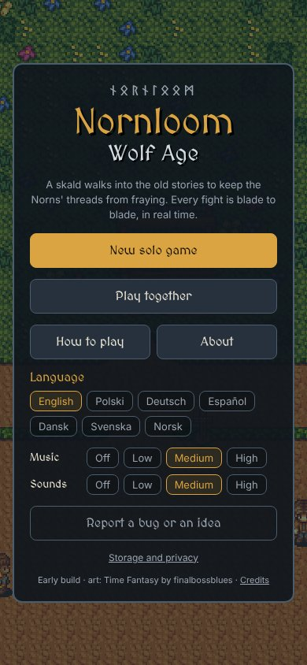

Press **New solo game** to make your first hero. **How to play** opens the game's own help book, the same rules as this guide in more detail. Once you have a hero, the title screen lists every hero on the device, and you can keep several.

Signed in, you can also press **Play together** to take a hero into a shared world with other players. Start alone: the first lands teach you everything you need there.

### 2. Make a hero

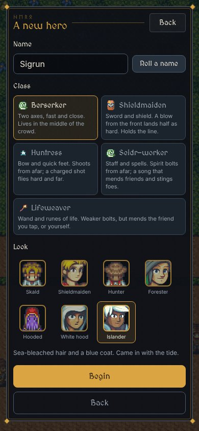

Type a name or press **Roll a name**. Then choose a class, which decides how you fight, and a look. Press **Begin**.

| Class | How it fights | Its two arts |
| --- | --- | --- |
| **Berserker** | Two axes, fast and close. Lives in the middle of the crowd. | Axe Storm and Wolf Leap |
| **Shieldmaiden** | Sword and shield. A blow from the front lands half as hard. Holds the line. | Shield Rush and Ring of Iron |
| **Huntress** | Bow and quick feet. Shoots from afar; a charged shot flies hard and far. | Fox Step and Thorn Ring |
| **Seidr-worker** | Staff and spells. Spirit bolts from afar; a song that mends friends and stings foes. | Spirit Walk and Galdr Song |
| **Lifeweaver** | Wand and runes of life. Weaker bolts, but mends the friend you tap, or yourself. | Eir's Touch and Shelter Rune |

Not sure? The **Berserker** is the simplest to start with: stand next to a beast and keep hitting. You can take up another class later, for gold, at the Skills screen.

### 3. The cold open

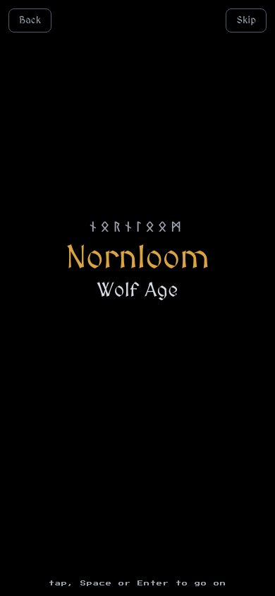

Skuld, one of the Norns, tells you why the threads of fate are fraying. Tap the screen to go on, or press **Skip** in the corner. You can watch it again from the title screen whenever you like.

### 4. The screen

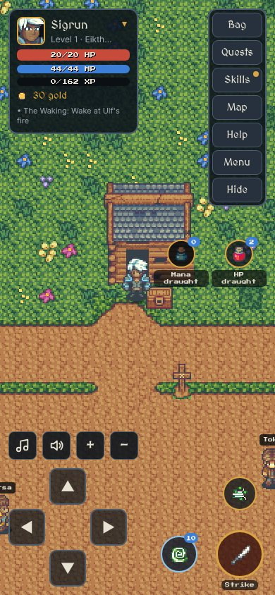

You wake in Eikthorp, your village. This is everything on the screen:

- **Top left:** your hero. The red bar is your health (HP), the blue bar your mana (MP), the dark bar your experience (XP). Under them, your gold and the next thing to do. Tap the plate to make it smaller.
- **Top right:** the menu. **Hide** folds it away so you see more of the map.
- **Under the menu:** your draughts, with the number you carry. Tap one to drink it.
- **Bottom left:** the arrow pad. Hold an arrow to keep walking. Above it: music, sound, and **+** and **-** to zoom the map.
- **Bottom right:** the fight buttons. **Strike** is the big one in the corner.

### 5. Talk to someone

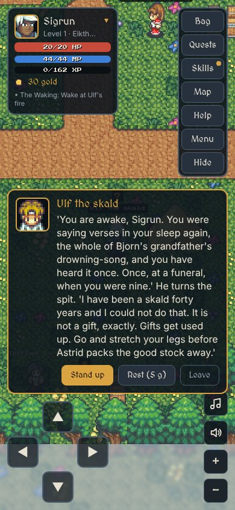

Walk into a person to talk. Ulf the skald is your first conversation: read what he says, then press the gold button (**Stand up**). The buttons under the words are what you can do: rest, trade, or **Leave**.

Your first quest, The Waking, is four short talks around the village: Ulf, Astrid the trader, someone at the well, and Groa the völva. Nobody fights you inside the village.

### 6. Take a quest

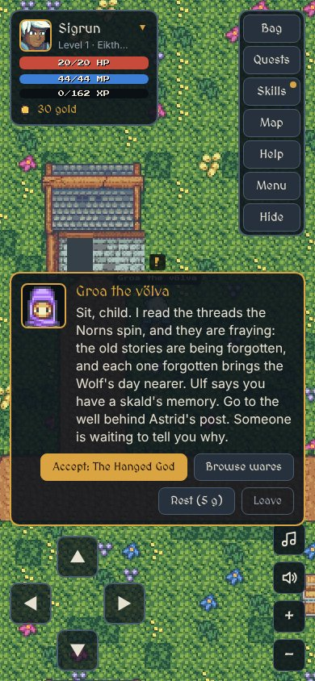

When the Waking is done, Groa offers **The Hanged God**, the first saga. Press **Accept**. The sagas are the old myths themselves, and there are 18 of them in one long chain, from Odin on the tree at level 1 to Ragnarök at level 86, with 13 side sagas along the way.

Every saga ends with a **retelling**: the person who gave it asks you what happened, and only the right answer pays. Listen to the story as you play it.

### 7. The quest log

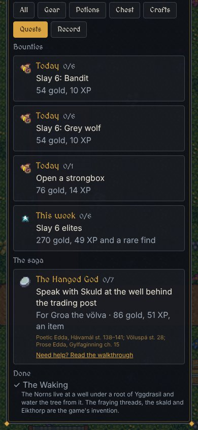

Press **Quests** in the menu. At the top are the **bounties**: small jobs that renew every day and every week, for gold and experience. Under them is each quest under way, with what to do next and where. **Need help? Read the walkthrough** opens that quest's page in [the quest guide](QUESTS.md).

### 8. Find a beast

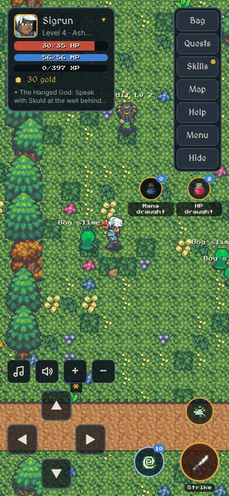

Walk out of the village into **Ashgrove Meadows**. The beasts there are slimes, bats and bandits. The colour of a beast's name says how hard the fight is: **green** is easy, **yellow** fair, **light red** hard, **dark red** deadly. Start with green and yellow.

Calm beasts leave you alone until you hit them. Fierce ones come for you when they see you.

### 9. Strike

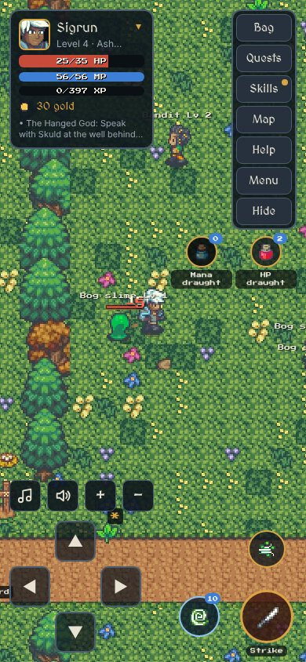

Walk up to the beast and press **Strike**. The number that rises is the damage you did. Hold Strike down to charge a heavier blow. **Tap a beast** to make it your target: a gold ring shows round it, and your blows turn to it.

Watch the beast, too. Before it hits, it winds up and marks the ground. Step away, or press the **dodge roll** button just above Strike: for most of the roll nothing can touch you.

### 10. Use your art

The button left of Strike is your class's first **art** (for a Berserker, **Axe Storm**). It costs mana, the blue bar, and then needs a few seconds before it is ready again: a dark slice sweeps round the button like a clock hand while it waits. Your second art opens at level 4, for a point in the skill tree.

### 11. Win

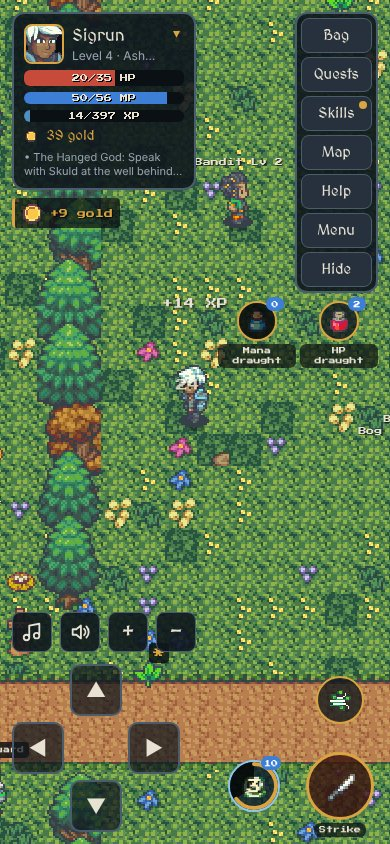

When a beast falls, the gold and experience it pays rise over your hero, and now and then it leaves a find: common, uncommon or rare gear goes straight into your bag. Fill the dark XP bar and you gain a level, which fills your health and mana and gives you a skill point.

Hurt? Stop fighting for 5 seconds and you rest where you stand: health and mana come back by themselves. A draught is quicker, and Ulf and Groa rest you to full at once for 5 gold a level.

### 12. Your bag

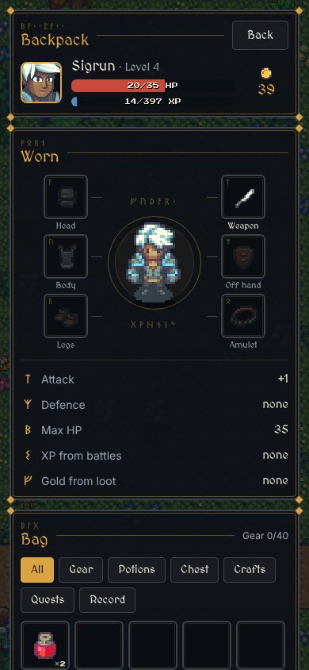

Press **Bag**. At the top is the gear you wear: head, body, legs, weapon, off hand and amulet, and under it what each piece adds. Tap a piece in the bag to read it, then press **Equip** to wear it. The bag holds 40 pieces of gear; your chest at home holds 200 more. Smiths sell gear and forge it stronger; healers sell draughts.

### 13. Your skills

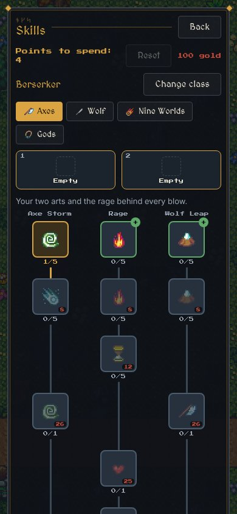

Every level brings skill points. Press **Skills** (it has a dot when you have points to spend), tap a skill to read it, and learn it. Your class has two trees of its own, one for its arts and one for staying alive, and every class shares a third, the Nine Worlds of fire, storm and frost. Every skill shows from the start with the level it opens at, so you can plan ahead. No hero fills every tree, so choose; a reset gives the points back for gold.

On the **Gods** tab you pledge yourself to one god, who blesses you more as you climb. The first pledge is free.

### 14. The map

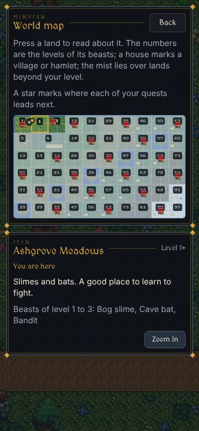

Press **Map**. Each square is a land, with the levels of its beasts. Tap one to read about it. Lands you cannot enter yet are misted; a rune stone at the border says the level you need. The road runs from level 1 here to level 99, about 100 hours of play, so take your time.

### 15. Waystones and home

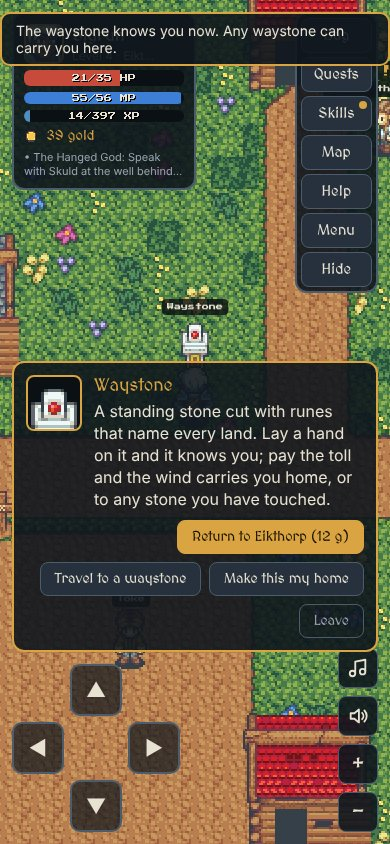

Every land has a **waystone**, a rune pillar. Walk into one and it knows you. From then on any waystone can carry you home, or to any other waystone you know, for a small toll. Beside a village's waystone you can make that village your home, and your chest waits there. A horse is much faster on the roads, but only the far hamlets of the lands from level 30 sell one, for 100000 gold. Most heroes walk for a long time before they can buy one.

### 16. A fall

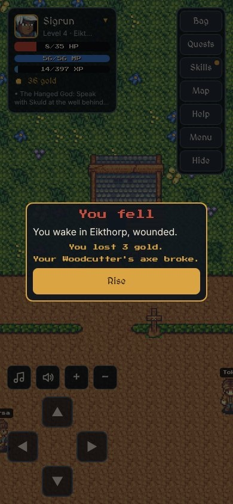

If your health runs out, you fall. You wake in the nearest village whose waystone you have touched, with 25 percent of your health. A fall costs 10 percent of the gold you carry, and one time in 10 a piece of the gear you wear breaks. So rest before a hard fight, and leave the red names for later.

---

## Every control

The same two tables as the game's help book (Help, then Getting started and Fighting).

**Walking and the world**

| Button or key | What it does |
| --- | --- |
| Arrows or WASD | walk (hold to keep going) |
| Phone or tablet | hold the arrow pad in the bottom left corner to walk; the round buttons in the bottom right fight |
| Walk into someone | talk, trade, rest, gather or open a strongbox |
| Enter or Space | do what the open plate offers: gather, open your chest, open a strongbox |
| Escape | close a conversation, turn back from a border |
| R | get on your horse or off it |
| + and - | zoom the map in and out (so do the + and - buttons above the arrow pad) |
| The menu | Bag, Quests, Skills, Map and Help at the top right; Hide folds it away |

**Fighting**

| Button or key | What it does |
| --- | --- |
| Strike: J, Space or a click | a blow with your weapon; hold it to charge a heavier one. A bow or a staff shoots from afar |
| Tap a beast | make it your target, with a gold ring: your blows and shots turn to it. You still walk and strike yourself |
| Arts: U and I, or 1 and 2 | your class's two arts. Each costs mana and is ready again after its wait |
| Spells: Q and E, or 3 and 4 | the two spells in your slots, learnt in the skill tree; they cost more mana |
| Dodge: K or Shift | a quick roll the way you walk; nothing can touch you for most of it, so roll through a beast's blow as it lands |
| Draughts: H and M, or 5 and 6 | drink a healing or a mana draught on the spot |
| Pause: P | stop the world while you think |

---

## Where next

- **Stuck on a quest?** [The Skald's Road](QUESTS.md), the quest guide: every saga step by step, with where to go, what is said, what to fight, the riddles' answers and the rewards. It is on the game's own site too: [fight.nornloom.com/guide](https://fight.nornloom.com/guide).
- **A question?** [The FAQ](FAQ.md), the same questions and answers as the game's help book.
- **The rules in full?** [The handbook](HANDBOOK.md): every class, art, skill, spell, god, armour set and land with its numbers. In the game, press **Help**.
- **Found a bug or have an idea?** The [issue forms](https://github.com/bc4all/Nornloom/issues/new/choose) of this repository.
